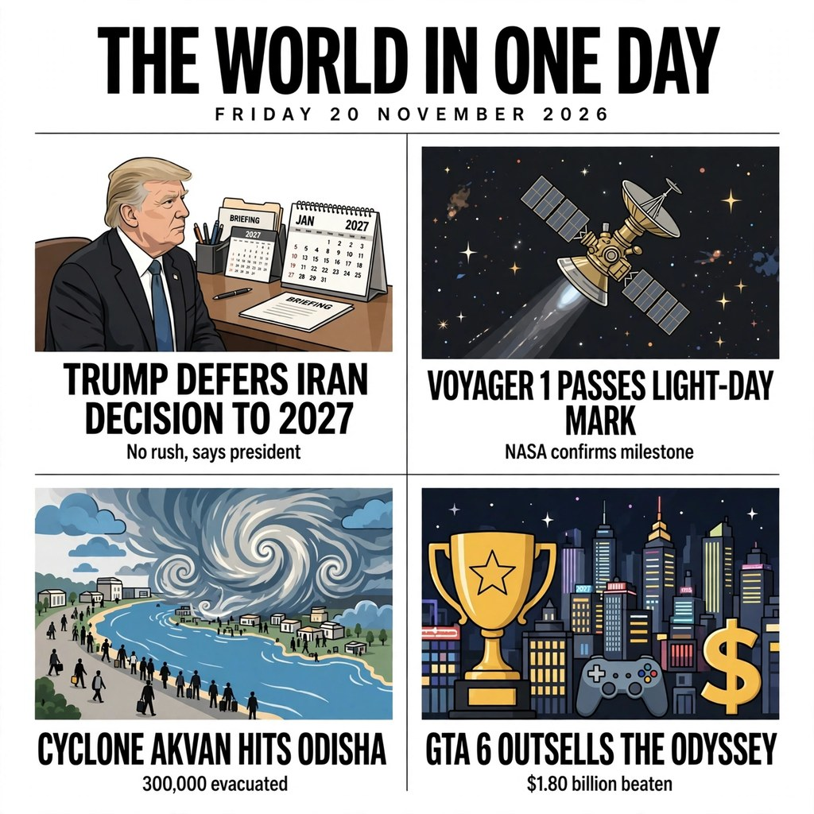

# The World in One Day — Friday 20 November 2026

[](https://make.fun/bounty/news-image-20261120)
[](https://make.fun/bounty/news-image-20261120)
[](https://make.fun/bounty/news-image-20261120)

A single newspaper-style image that sums up the world's news of Friday 20 November 2026 — four stories, one page. This is my entry for the [make.fun](https://make.fun/bounty/news-image-20261120) competition **news-image-20261120**.



## The four stories

- **Trump defers the Iran decision to 2027.** The US president said there was "no rush" and that he would "see what happens" after 1 January, pushing any decision on Iran into next year.
- **Voyager 1 passes a light-day.** NASA confirmed the farthest human-made object has now travelled more than a light-day from Earth — a milestone for a spacecraft launched in 1977.
- **Cyclone Akvan bears down on Odisha.** Around 300,000 people were evacuated and 423 rescue teams deployed as the cyclone headed for landfall on India's east coast.
- **GTA 6 outsells The Odyssey.** The game's sales have already passed the $1.80 billion global run of The Odyssey, a striking marker of how big launch-day entertainment has become.

## How the image was made

The image was generated as a flat editorial front page: a bold masthead naming the day, then a two-by-two grid of illustrated panels, one per story, each with a short headline and a single line of supporting text. It was then resized to exactly 1024 × 1024 pixels and saved as a JPEG, so it stays legible when viewed small and within the competition's size limit.

## Running it

The program is Python 3.13, standard library only. It copies the shipped image to the output directory:

```sh
MAKEFUN_OUTPUT_DIR=out python3 main.py
```

This writes `out/entry.png`, byte-identical on every run.

---

Built for make.fun — try it yourself: https://make.fun/r/1e3qpbvy
